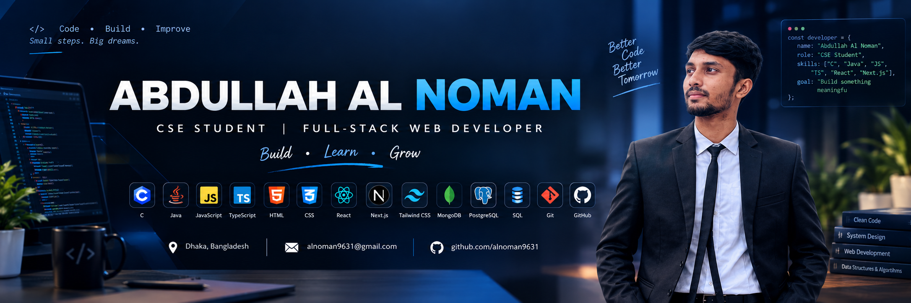

# Hi 👋, I'm Abdullah Al Noman

**CSE Student &nbsp;|&nbsp; Full-Stack Web Developer &nbsp;|&nbsp; Software Development Enthusiast**

`Building` • `Learning` • `Growing`

---

## 👨‍💻 About Me

I'm a Computer Science and Engineering student from Dhaka, Bangladesh, learning programming and software development step by step. I started with the fundamentals of **C programming**, and from there I moved into web development.

Today I work with **React** and **Next.js**, and I'm learning **TypeScript**. I also practice **databases and SQL** and keep improving my **Data Structures and Algorithms**. I learn best by building real projects, and I enjoy solving practical problems through software.

---

## 🚀 What I'm Currently Doing

- 🔹 Working on full-stack web development projects
- 🔹 Exploring Next.js
- 🔹 Improving my React and TypeScript skills
- 🔹 Practicing JavaScript
- 🔹 Practicing C programming
- 🔹 Learning SQL and database management
- 🔹 Practicing Data Structures and Algorithms
- 🔹 Building projects to improve my development skills
- 🔹 Improving my problem-solving skills

---

## 🛠️ Skills & Technologies

**Programming, Frontend & Tools**

  

**Databases**

  

---

## 📚 Currently Learning

---

## 🧭 My Development Journey

The path I'm following as I learn, not a list of things I've mastered.

  

 ⬇ 

 ⬇ 

 ⬇ 

 ⬇ 

 ⬇ 

 ⬇ 

 ⬇ 

---

## 🚀 Featured Projects

<table width="100%">
  <tr>
    <td>
      <h3>🏋️ <a href="https://github.com/alnoman9631/fitlog">FitLog</a></h3>
      
A modern responsive workout tracking web application that allows users to explore workouts, view workout details, save workouts, and manage a personal workout plan.

      

        
        
        
        
        
      

      

        <a href="https://github.com/alnoman9631/fitlog">📂 GitHub Repository</a>
        &nbsp;•&nbsp;
        🌐 Live Demo: <code>LIVE_DEMO_URL_TO_BE_ADDED</code>
      

    </td>
  </tr>
</table>

<table width="100%">
  <tr>
    <td>
      <h3>🧱 <a href="https://github.com/alnoman9631/DevStack">DevStack</a></h3>
      
A React-based developer technology stack builder where users can explore development technologies and build their own technology stack.

      

        
        
        
        
        
      

      

        <a href="https://github.com/alnoman9631/DevStack">📂 GitHub Repository</a>
        &nbsp;•&nbsp;
        🌐 Live Demo: <code>LIVE_DEMO_URL_TO_BE_ADDED</code>
      

    </td>
  </tr>
</table>

---

## 💡 What I Like Building

- 🌐 Web applications
- 🧰 Developer tools
- ⚙️ Practical software
- 📱 Responsive interfaces
- 🔌 API-based applications
- 🗄️ Database-driven applications
- 🧩 Projects that solve real problems

---

## 🎯 My Goal

My goal is to become a skilled software developer by continuously learning, building real-world projects, improving problem-solving skills, and developing strong software engineering fundamentals.

I want to build useful software that solves real-world problems.

---

## 📊 GitHub Stats

---

## 🔥 Contribution Streak

---

## 🌐 Connect With Me

---

**Thanks for visiting my profile!**

`Build` • `Learn` • `Grow`

# alnoman9631
